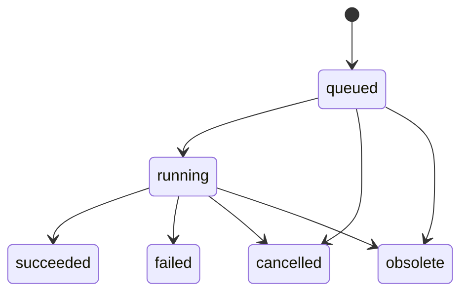

# 路线 API 与供应商适配草案

版本：v0.1，更新 2026-10-22。状态：**长期 API 草案；M1 编辑与 M2 实际记录、到访、私密图文／用户管理子集已实现，其余端点尚未实现**。数据含义以 [路线模型](route-domain-model.md) 为准。实际 URL 和请求字段以运行代码、共享契约与 TypeBox Schema 为准，尚未生成 OpenAPI；本稿中长期草案的路径可能与当前实现不同。范围见 [开发说明](development.md) 和 [M2 接口清单](m2-records.md#当前接口)。

## 1. 通用约定

- 建议前缀 `/api/v1`，使用 JSON；用户身份从服务端会话获取，不能信任请求体 `ownerId`。
- 当前关闭公开注册；使用端和独立管理端通过各自界面访问受权限控制的 API，管理入口不能只靠路径保密。
- ID 对调用者不透明；日期、时区、坐标、来源及统计口径遵循模型文档。
- 请求与供应商响应均做运行时校验。点数、文件大小、任务并发、调用量、候选生命周期等从服务端配置返回适用限制，不在前端写成永久额度。
- 私有对象越权访问统一按不存在处理；公开分享使用专门访客视图，不复用包含私密字段的编辑响应。

成功响应建议：

```json
{
  "data": { "routeId": "route_example", "version": 8 },
  "meta": { "requestId": "request_example" }
}
```

错误响应建议：

```json
{
  "error": {
    "code": "VERSION_CONFLICT",
    "message": "路线已在其他位置修改，请先合并当前内容。",
    "details": { "baseVersion": 7, "currentVersion": 8 }
  },
  "meta": { "requestId": "request_example" }
}
```

本文所有 `*_example`、版本号和路径示例均为虚构契约数据；不是现有服务地址、业务对象或凭据。

## 2. 读取、编辑与实际记录

| 方法及路径 | 输入／输出重点 | 规则 |
| --- | --- | --- |
| `GET /journeys` | 个人行程摘要、状态、游标 | 列表不返回所有几何点串和原图 |
| `POST /journeys` | 标题、目的地摘要、时区及可选日期 | 201；创建行程及空计划 route |
| `GET /journeys/{journeyId}` | 行程、plan／actual route 引用、日记摘要权限 | 完成状态不推导出实际到访 |
| `PATCH /journeys/{journeyId}` | `baseVersion`、幂等 ID、标题／目的地摘要等元信息 | 使用独立 journey 版本；出发地位置通过 route 命令更新，不重复保存 |
| `GET /routes/{routeId}` | 版本、days/stops/segments、几何摘要、诊断及任务引用 | 默认不嵌入全部点串 |
| `POST /routes/{routeId}/commands` | `baseVersion`、`clientMutationId`、操作列表 | 原子应用；成功 200 返回新版本、规范化状态、临时 ID 映射及失效路段 |
| `POST /journeys/{journeyId}/actual-copy-previews` | 计划 route 版本、actual 当前版本、复制范围、模式 | 只读计算影响；返回待新增／替换范围及受影响关联，不写数据 |
| `POST /journeys/{journeyId}/actual-copies` | 明确的 `append/replace`、版本、预览标识、幂等 ID | 201；事务内重新检查版本与预览一致性，生成独立业务 ID |
| `POST /visits` | 用户确认的地点快照、日期和可选 route/stop 引用 | 独立写入；不能由复制或算路接口顺带创建 |
| `DELETE /visits/{visitId}` | 明确撤销对象 | 204；不删除原行程和日记 |

`commands` 首批可支持：新增／修改／删除日期安排；新增、编辑、排序、跨日移动、删除 stop；设置连接类型／交通方式；采用允许保存的补绘或导入几何；采纳候选；核对路段；保护／解除保护几何。每个操作使用明确字段，不允许任意路径修改 owner、来源或使用策略。

例如只改备注：

```json
{
  "baseVersion": 7,
  "clientMutationId": "mutation_example",
  "operations": [
    {
      "type": "update_stop",
      "stopId": "stop_example",
      "patch": { "note": "在此休息后继续徒步" }
    }
  ]
}
```

服务端识别备注未改几何输入，不触发算路。真正改位置时提交带 CRS 的 `location`，由服务端计算受影响连接；前端不能自行断言“其他几何仍有效”。

新增对象可带本次命令内的 `clientRef`，服务端分配 ID 并返回映射；同批后续操作引用 clientRef 时只在该事务内解析，不将本机临时 ID 当成数据库 ID。所有跨对象引用检查属于同一用户、行程和 route。

### 草稿、冲突与重试

- v4 本机草稿继续可用；网络保存成功才展示对应服务端版本已保存，失败保留本机内容。
- `baseVersion` 不符返回 409。前端保留草稿、读取新版本并让用户合并，不自动覆盖。
- `clientMutationId` 在用户／操作范围内幂等；同 ID、同请求重试返回原结果，同 ID 不同内容返回冲突。先检查已有幂等结果，再将新请求的旧 baseVersion 判为版本冲突。
- 数据库短事务内校验归属、版本、操作、快照及幂等记录。算路、上传解析和模型请求在事务外进行。
- 预览标识包含服务端记录的输入范围、版本与摘要；客户端无法通过伪造摘要跳过替换检查。预览过期或内容变化时重新预览。

## 3. 地点搜索与确认选点

| 方法及路径 | 用途 | 边界 |
| --- | --- | --- |
| `GET /map-capabilities` | 返回当前启用的底图／搜索／路由能力、支持方式与约束、适用限制 | 不返回安全密钥或 WebService Key；普通用户看能力，管理端另管配置 |
| `POST /place-searches` | 关键词、区域、可选视图范围及选定搜索来源，返回候选 | 有限页、去抖和服务端限流，不作为对外任意供应商代理 |
| `GET /geometries/{geometryId}` | 获准展示的指定几何、CRS、版本、来源／署名 | 校验归属和使用条件；响应按用途及底图限制筛选 |

候选返回名称、类别、区域、来源与坐标系；展示“景区、入口、索道站、公交站”的区别。候选标识有生命周期，不能当永久业务 ID。地点选定后通过 route 命令保存快照；保存仍检查其适用使用范围，不能因用户点选而忽略来源限制。

地点搜索无结果或网络失败时允许手填名称，保留 `unlocated`；不能按文字生成假经纬度。前端来源选择只接受服务端声明的标识，不接受自定义上游地址或请求模板。

## 4. 自动算路：任务与候选

### 4.1 接口

| 方法及路径 | 行为 |
| --- | --- |
| `POST /routes/{routeId}/routing-jobs` | 首版单次一个 travel 段；校验输入、版本、能力和策略，202 返回任务 ID 与输入指纹 |
| `GET /routing-jobs/{jobId}` | 读取任务状态、可用候选摘要、诊断和可重试错误；按权限访问 |
| `POST /routing-jobs/{jobId}/cancellations` | 尽力取消；无法中止上游时不再自动接纳其迟到结果 |
| `POST /routes/{routeId}/commands` | `adopt_candidate` 操作主动采纳；重新校验版本、指纹、过期、归属与使用范围 |

启动请求示例：

```json
{
  "baseVersion": 8,
  "clientMutationId": "routing_mutation_example",
  "segmentId": "segment_example",
  "providerPolicy": "default",
  "constraints": {}
}
```

`providerPolicy=default` 指服务端可配置策略，不表示现在已决定按高德或 BRouter 上线。也可允许用户在已启用能力中明确选择来源。只接收真正支持的约束；不支持“必须避开所有高难度段”等要求时返回可识别错误，不静默丢弃。

202 响应示例：

```json
{
  "data": {
    "jobId": "job_example",
    "status": "queued",
    "routeId": "route_example",
    "segmentId": "segment_example",
    "inputFingerprint": "fingerprint_example"
  },
  "meta": { "requestId": "request_example" }
}
```

一次旅程有多个需计算段时，由界面或业务调度按服务端限制逐段创建任务；允许部分成功，不因一个失败撤销其他已确认段。是否提供批量接口后续按实际需求扩展。

### 4.2 任务状态



重试建立新执行记录并关联原任务，避免已失败记录被改写得无法追溯。服务端配置超时、有限重试、退避与去重，不对未知网络故障无限请求公共服务；前端重复点击不能绕过限流。

后台输出 `succeeded` 意味着获得可解析候选，不意味着路线正确。候选记录：

| 范围 | 字段含义 |
| --- | --- |
| 输入 | 路段、启动版本、输入指纹、请求位置／坐标系、交通意图、实际生效约束 |
| 来源 | 供应商、引擎／profile 版本或哈希、请求日期、已知的数据版本 |
| 结果 | 允许保留的几何或临时句柄、原始 CRS、实际首尾、偏移、断段、可空统计 |
| 使用与核对 | 来源／署名、策略引用、候选有效期、诊断码、review 状态 |

候选生命周期与保存方式按实际使用条件确定。禁止或未核实长期保存时，不能将完整供应商响应塞入 job JSON 规避策略；若业务所需暂存／预览本身也不具备适用条件，应在调用前拒绝该能力。

### 4.3 迟到结果

1. 启动后用户改了起点、方式或相关配置：输入指纹不同，返回时标 `obsolete`，不改当前几何。
2. 只改了不参与计算的备注：任务结果仍可作为候选；采纳提交当前 route 版本。
3. 路段已删除：不把结果挂到同名新段上。
4. 路段被锁定或已有手绘：候选可供允许范围内查看，但采纳需明确操作及保护状态校验。
5. 上游成功但终点偏离／有缺口：保留诊断与 `needs_attention`，先处理选点或说明异常；不自动补直线或标记已确认。

## 5. 导入、补绘与导出

| 方法及路径 | 行为与边界 |
| --- | --- |
| `POST /route-imports` | 接收受限大小的 GPX／GeoJSON 与来源／归属声明，202 解析；不直接覆盖路线 |
| `GET /route-imports/{importId}` | 返回解析状态、原坐标系、多段、有效时间／高程及缺失诊断 |
| `POST /routes/{routeId}/commands` | 采用选定导入部分或补绘，保留来源、坐标及原始资产引用；不把参考文件自动标实录 |
| `POST /routes/{routeId}/export-previews` | 指定版本、范围、格式和统计选项；列出可导出、未定位、过期、断段和策略阻断 |
| `POST /routes/{routeId}/exports` | 明确采用预览范围、版本和选项，202 创建导出任务；完成后给受控下载引用 |

GPX 首版建议：默认不导出时间或高程；可按来源显式选择实录或模型高程，说明来源与垂直基准。模型累计秒数不能变成真实点时间；计划复制到实际也不改变这一规则。

所有点必须具有已确认的可导出 WGS84 表达；转换未实现或使用条件不满足时返回阻断原因。多段分别输出 `trkseg`，不连接缺口。默认不忽略无几何／过期的 travel 段；若用户明确选择部分导出，预览须列出遗漏段并绑定该选择，不能静默生成看似完整的文件。

gap 可以表现为分段边界，但不作为连接线或运动统计。存在 `needs_attention` 时先解决或由用户对允许确认的异常作明确核对；用户确认不能覆盖使用权限限制。下载时重新检查可见性、资产使用条件及有效期，分享链接不等于资产永久公开。

## 6. 供应商适配契约

业务层只调用固定适配器，不直接依赖 AMap／BRouter 的响应字段。建议将搜索和路由分为独立能力：

| 适配器操作 | 输入 | 规范化输出 |
| --- | --- | --- |
| `capabilities()` | 当前服务配置 | 可用模式、输入／输出 CRS、途经点与约束、适用使用策略 |
| `searchPlaces()` | 关键词、区域、分页／视图上下文 | 候选、来源、CRS、有效期及诊断 |
| `calculateSegment()` | 明确坐标、交通意图、支持的约束、profile 配置、取消信号 | 候选几何、请求与实际端点、独立指标、版本、来源及诊断 |
| `convertForDisplayOrExport()` | 原资产引用、目标 CRS、用途与策略 | 可追溯派生表达，或明确失败；不覆盖原始资产 |

坐标转换可为独立模块，不要求每家地图供应商都实现。不同供应商默认交通策略不同，切换时明确来源与生效条件；不能因某家返回失败就把另一家的结果悄悄写成同源数据。

上游字段如 BRouter `track-length/filtered ascend/total-time` 与本站指标一一记录依据；缺字段、负值、非有限数值、空路径、维度错误、回显端点与几何不一致均产生可识别诊断。原始响应只在允许范围与期限内保留，日志不记录密钥、带凭据 URL 或完整私密正文。

## 7. 错误与界面行为

| 错误码建议 | HTTP 建议 | 使用端行为 |
| --- | --- | --- |
| `VALIDATION_ERROR/INVALID_GEOMETRY/CRS_REQUIRED` | 400／422 | 指向具体字段，保留本机草稿 |
| `UNAUTHENTICATED` | 401 | 保留草稿后引导登录 |
| `NOT_FOUND` | 404 | 不暴露他人对象存在性 |
| `VERSION_CONFLICT/IDEMPOTENCY_CONFLICT` | 409 | 保留草稿，读取并合并或修正重复请求 |
| `CANDIDATE_EXPIRED/INPUT_CHANGED/GEOMETRY_LOCKED` | 409 | 不采纳旧候选，提示重新核对或计算 |
| `LOCATION_UNCONFIRMED/UNSUPPORTED_MODE/UNSUPPORTED_CONSTRAINT/CRS_CONVERSION_UNAVAILABLE` | 422 | 补齐位置或调整明确支持的选项 |
| `POLICY_UNVERIFIED/POLICY_DENIED` | 422／403 | 给出保存／展示／导出哪个用途受限；不让用户点确认绕过 |
| `NO_ROUTE/ENDPOINT_MISMATCH/PARTIAL_COVERAGE` | 任务失败／候选诊断；同步校验可用 422 | 保留已成功段，处理当前段，不伪装完整路线 |
| `RATE_LIMITED` | 429 | 按服务端提示重试，保持当前内容 |
| `UPSTREAM_INVALID_RESPONSE/UPSTREAM_TIMEOUT/SERVICE_UNAVAILABLE` | 同步 502／504／503；异步记录失败码 | 明确暂时失败，允许有限重试，不默认无路 |

异步任务 GET 本身成功时返回 200，任务内部错误在 `data.failure`／候选诊断中表达；不会因轮询读取一个失败任务就把整个 HTTP 请求当上游故障。

## 8. 使用端、管理端和首版范围

使用端只需要路线编辑、选点、计算与核对、实际记录、到访、日记及分享。用户管理、供应商凭据／策略、思源同步审核、任务管理和审计由独立管理端承担；建议 API 使用 `/admin/...` 权限域，后端仍可共用一个服务。

第一批实现可先完成：登录会话 → 行程与两层路线 → 命令保存／冲突 → 手工选点与补绘 → 独立到访／日记关联。算路任务、GPX 与资料导入按验证通过的能力接入，不能为交付首个编辑流程而等待全部供应商或 AI。

当前首批页面、端点子集、迁移组和 A1–A10 验收建议见 [实施清单](implementation-plan.md)，依阶段逐步实现，不要求本稿所有端点一次交付。

模型与接口在文档中有样例，并不代表服务端权限、事务、并发、上传、导出或 OpenAPI 已实现。下一次实际开发前据此确定首批端点和数据库迁移，再建立相应验收场景。
