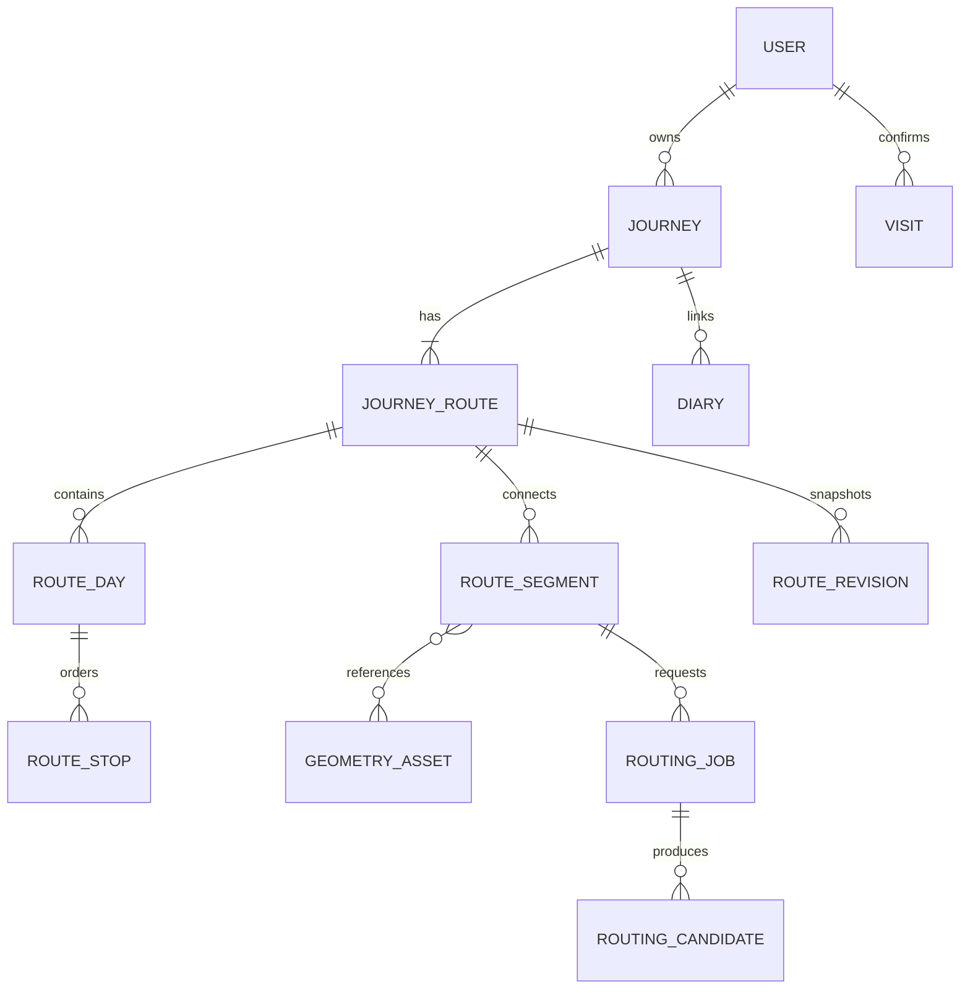

# 行程与路线数据模型草案

版本：v0.1，更新 2026-10-22。状态：**长期模型建议稿；M1 编辑、M2 记录、M3.1 手工几何／GPX 子集已建表，算路任务等后续实现**。依据 [产品方案](product-plan.md)、[v4 原型](prototype-design.md) 及 [地图验证](validation-plan.md)。接口配套见 [路线 API 草案](route-api-contract.md)；实际字段以 `backend/src/db/schema.ts` 与共享契约为准，实施边界见 [M2](m2-records.md) 和 [M3](m3-maps.md)。新增字段与约束不因归档自动变成用户已确认决定。

## 1. 模型要表达的事实

- 一趟行程可以跨城、跨日，包含驾车、公共交通、徒步和未确定的接驳。
- 计划与实际记录独立；两者都允许包含规划、参考导入与补绘。
- “实际记录”表示用户回程整理的内容，不能自动将几何标为 GPS 实录。
- 地点文字可以先保存；没有定位时，不生成假坐标或直线轨迹。
- 用户确认到访是独立行为，标记完成、复制计划、采纳路线均不自动点亮足迹。
- 地图、搜索与算路供应商分别适配，业务 ID 不依赖供应商 POI ID。

## 2. 对象与关系



图表达概念关联，不是已执行的 MySQL DDL。`geometry_asset` 保存可保留的来源几何及派生关系；复用、导入或复制时通过独立关联引用，不能通过改写来源把参考数据变成个人实录。

### 2.1 行程、计划与实际

| 对象 | 核心字段建议 | 规则 |
| --- | --- | --- |
| `journey` | `id`、`owner_id`、标题、状态、时区、目的地摘要、版本、创建／修改时间 | 状态为 `planning/completed/archived`；目的地不等于到访记录 |
| `journey_route` | `id`、`journey_id`、`owner_id`、`layer`、`version`、备注 | `layer=plan/actual`；同一行程每层最多一个当前对象，计划必有、实际按需创建 |
| `route_day` | `id`、`route_id`、顺序、可空日期、地区／住宿说明 | 按顺序组织，日期可未定；计划与实际的 day 不共用可变行 |
| `route_stop` | `id`、`route_id`、`day_id`、顺序、角色、地点快照、选填时间、备注 | 同一地点多次出现使用不同 stop ID，支持往返、住宿和跨日移动 |
| `route_segment` | `id`、`route_id`、起终 stop ID、类型、交通方式、几何引用、状态、输入指纹 | 表示相邻地点之间的安排或缺口；不要求每段都有几何 |
| `route_revision` | `route_id`、版本、修改者、时间、原因、业务快照／几何引用 | 用于回查与恢复；保存紧凑业务数据，不重复嵌入全部点串 |

首个出发地建模为 `role=departure` 的 stop；其他角色可为 `visit/waypoint/transfer/overnight`。详情上的出发地由对应路线节点派生，避免另存一份坐标产生冲突。目的地摘要可先存在行程 JSON 中，后续有真实检索需求再独立规范化。

时间口径：每日日期为本地 `YYYY-MM-DD`，排程时间可选 `HH:mm`，由行程时区解释，默认 `Asia/Shanghai`；审计与任务时间为 UTC 时间戳。实际记录中的用户填写时间与 GPS 样本时间分别保存。

### 2.2 地点快照与定位

地点出现在行程里时保留当次选择的快照，避免资料库、供应商 POI 或思源更新后改变旧行程。

| 字段 | 建议含义 |
| --- | --- |
| `label`、`regionLabel`、`role` | 用户看到的名称、地区、使用角色 |
| `location` | 可空，经度、纬度和明确坐标系 |
| `locationStatus` | `unlocated/candidate/confirmed`：未定位、候选、用户确认选点 |
| `locationSource` | 手工选点、供应商 POI、OSM、照片 EXIF、文件或资料引用 |
| `providerRef` | 可空的供应商／外部 ID，不作为本站业务主键 |
| `sourceRefs`、`policyRef` | 来源、抓取／核验日期及适用使用范围 |

用户确认选点不证明现场入口可通行；文字修改不等于坐标变化。照片 EXIF 给出的是拍照位置，不能直接生成拍照点之间的真实路径。“云谷寺/索道”先保留文字或多个候选，不自动折成唯一地点。

首版可以在 stop 中使用经过校验的快照 JSON；不必先建设全国地点库。以后抽取独立 `place` 时保留快照与引用的区别。

## 3. 路段、几何和来源

### 3.1 相邻连接

将每天 stop 按路线顺序展开，相邻 stop 之间建立连接：

- `kind=travel`：有交通安排，`mode=walk/hike/drive/transit/rail/flight/bike/boat/other/unknown`。
- `kind=gap`：未交代、暂不连接或过夜等间隔，保留原因；不生成路线、不计入运动距离或耗时。

跨日连接默认是待处理缺口，由用户决定是否需要接驳。连接关联起终点所在日期，在到达日列表显示；不把跨午夜／过夜时间自动计入运动统计。

列表中的“到达方式”由入站 travel 段派生，避免同时在 stop 和 segment 保存两份交通方式。`walk` 与 `hike` 是业务意图，是否真有对应路由能力由适配器声明；不能悄悄把徒步要求降级为城市步行。

### 3.2 来源与状态分开

| 维度 | 值 | 含义 |
| --- | --- | --- |
| 所属记录 | `plan/actual` | 行前安排或回程整理，属于 route |
| 几何来源 `sourceKind` | `routing/imported_reference/gps_recording/manual` | 路由结果、参考轨迹、本人设备实录或人工补绘，属于几何 |
| 几何状态 `geometryStatus` | `missing/ready/stale` | 缺失、对应当前输入、已因输入变化过期 |
| 核对状态 `reviewStatus` | `unreviewed/needs_attention/confirmed` | 未核对、有异常、用户已核对该版本 |
| 编辑保护 `geometryLocked` | 布尔值 | 用户保留的几何不能被后台自动覆盖 |

`gps_recording` 需要实录来源及归属说明；不能因为文件是 GPX、带时间或被复制到 actual 层就自动赋值。`confirmed` 仅代表用户对当前数据的核对，不宣称系统完成现场安全认证。

计算任务状态另存为 `queued/running/succeeded/failed/cancelled/obsolete`。任务成功不自动采纳几何，几何可展示也不自动通过核对。端点偏移、缺失部分、权限与统计缺值各有独立诊断，不用一个“成功”布尔值覆盖。

### 3.3 内部几何格式

```ts
type CRS = 'WGS84' | 'GCJ02' | 'BD09';
type Position2D = [longitude: number, latitude: number];

interface RouteGeometry {
  kind: 'polyline';
  crs: CRS;
  parts: Position2D[][]; // 每部分至少两个点；各部分之间不自动连接
}

interface Location {
  longitude: number;
  latitude: number;
  crs: CRS;
}
```

这是本站内部 JSON，**不直接称为标准 GeoJSON**。GCJ-02／BD-09 数据不因字段长得像坐标数组而成为 WGS84。服务端验证范围、有限数值、点数、各部分长度和来源；未知坐标系可留在待处理导入中，不能直接进入计算与导出。

保留原始坐标系与数据版本；转换产生新的派生资产，记录原资产、算法／版本和用途，不反复覆盖原始点。高程与时间序列另带 `measured/estimated`、来源和可空的垂直基准；不把模型时间写成 GPS 采样时间。

原始大文件放受控文件／对象存储，业务表保存引用、校验和、大小及解析版本。少量几何可起步存在 MySQL JSON，超过配置阈值再用资产文件；不预先为全国路网建立业务数据库。

### 3.4 输入点与实际端点

每个候选保留请求起终点、所用坐标系、几何实际首尾、贴合／偏移距离、指纹及诊断时间。内部断段也保留，不只核对外层首尾。

高德长坪沟样本约 837m 的终点偏移应进入 `needs_attention`，不补直线、不默认到达。小偏移是否可接受由场景规则和用户选点决定，当前不定一个覆盖所有场景的硬阈值。

## 4. 统计字段与展示

每项指标单独带单位、来源和依据：

```ts
interface Metric {
  value: number | null;
  unit: 'm' | 's';
  basis: 'provider_estimate' | 'geometry_2d' | 'dem_estimate'
    | 'recorded_samples' | 'user_reported';
  sourceRef?: string;
}
```

- 保留供应商距离与自己的二维线长；BRouter 样本的 3123m 与累加约 3127m 不强行覆盖为同一个字段。
- 高程模型爬升与文件实录爬升分开，算法版本另记；缺失为 `null`，不填 `0`。
- 行程 actual 层采用规划几何时，距离和时间仍展示为规划估计。
- 汇总给出覆盖范围，如“已计算 3／5 个徒步段”，不将缺失段当成零距离；分别统计徒步和其他交通方式。
- 多段之间不连线计程；过夜、停留、交通等待和运动时间分开。没有有效连续实录时，不从照片或路由模型生成个人速度。

## 5. 来源、使用范围与共享

每个外部地点、几何、文件或派生数据保留 `sourceRefs`、署名、许可／适用范围、获取日期、核查依据及 `policyRef`。服务端策略对“保存、编辑、分享、GPX 导出、跨底图展示”分别返回 `allowed/denied/unverified`。

策略由服务端根据已核实的使用范围决定，客户端不能提交“允许导出”来授权自己。未知不自动当允许；临时预览也按相应服务使用条件处理。源资产与派生版本继承来源和限制，手工编辑、复制或换坐标系不会自动清除限制。

不允许长期保存的候选使用合规的临时存储／生命周期，不能因为 `routing_job` 入库就把供应商完整响应永久放进数据库。历史版本和备份也要遵守同样的保留边界。

分享按服务端可见性与资产策略裁剪。行程公开不自动公开关联私密日记、思源原文、原图或不允许展示的供应商几何。业务 ID、媒体和几何引用均校验归属，不能依赖前端隐藏。

## 6. 编辑、版本和计算并发

### 修改影响

| 改动 | 应发生的事 |
| --- | --- |
| 改名称、备注、照片说明 | 不改变几何输入，不触发算路 |
| 改具体坐标或交通方式 | 使受影响路段的旧几何变为 stale，核对失效；保留可用历史引用 |
| 排序、插入、删除、跨日移动 | 比较修改前后有向相邻关系，只创建或作废变化的连接 |
| 切换地图查看模式 | 不改路线数据、不自动重新计算 |
| 主动采纳候选 | 校验版本、输入指纹、归属和使用范围，生成独立几何引用，核对状态依诊断确定 |

例如 `A→B→C→D` 改为 `A→C→D→B`：`C→D` 可保留；旧 `A→B/B→C` 退出当前连接，新 `A→C/D→B` 待安排。跨日变化仍需重新检查 gap／travel 意图，不把日期移动等同于增加徒步。

手绘、导入或锁定几何不会被自动算路替换。起终点变动后仍可保留旧资产供回查，但必须标过期，不能继续按已核对当前线路汇总或导出。

### 保存与版本

采用每条 route 的递增 `version` 做乐观并发控制。客户端提交 `baseVersion`，服务端在短事务中校验并应用操作、更新版本和快照；冲突返回可识别的 409，不静默覆盖其他设备修改。外部算路不在数据库事务中进行。

任务记录启动版本与 **输入指纹**：有向起终点、具体坐标及 CRS、交通方式、所选供应商与 profile／版本、实际支持的约束及算法相关配置。后台返回后再次核对；变化则标 `obsolete`，不能覆盖现有路线。

仅备注变化虽然提升 route 版本，却不必丢弃仍匹配的计算结果；以输入指纹和路段是否存在为依据，采纳时再校验当前保存版本。后台只产生候选，采纳是独立用户操作。

## 7. 复制计划、到访与日记

- 复制时选定计划版本与实际当前版本；实际不存在时创建，已有内容必须明确 `append/replace`。
- 复制生成新的 day／stop／segment ID，保留 `copiedFrom`；可引用允许复用的不可变几何，不共用可变业务对象。
- append 新增独立安排，不按相同地点自动合并或覆盖；具体插入日由用户确认，日期重复不自动拼接为一条路。
- replace 先展示将替换的范围，保留可恢复版本；不级联删除到访、日记或照片。失去当前节点关联时保留历史快照并提示重新关联。
- `visit` 独立记录地点／地区快照、确认日期、可选 trip／stop 及用户来源。即使关联节点删除，也不静默删除已确认到访；取消到访需明确操作。
- 日记与照片可关联行程、某天或地点，保留关联名称快照；来源笔记更新和路线重算不改已写内容。

## 8. MySQL 落地次序建议

| 阶段 | 表或存储 | 目的 |
| --- | --- | --- |
| 核心编辑 | `journeys/journey_routes/route_days/route_stops/route_segments` | 保存计划、实际与混合交通；owner_id 和版本从首版加入 |
| 几何与回查 | `geometry_assets/route_revisions` | 保留原始／派生引用，去重保存点串，恢复业务版本 |
| 自动算路 | `routing_jobs/routing_candidates` | 限并发、过期、重试及候选采纳；不要求 Redis |
| 记录与分享 | `visits/diaries/media/shares` 及其必要关联 | 与对应功能一起建，不在本稿一次性执行全部迁移 |
| 资料建设 | 来源快照、模板、审核及同步任务 | 与思源导入专题进一步设计，不让更新覆盖旧行程 |

各表通过 route／journey 外键及服务端归属校验防止跨用户引用；为 `owner_id`、route/day 顺序、任务状态与时间等实际查询建立索引。排序可先用事务内整数顺序重排，小规模个人数据不先引入复杂排序服务。

历史与临时文件设置可配置保留策略，不能承诺永久保留每次完整快照；清理不删除当前有效资产，且考虑来源限制和备份恢复。具体 DDL、数据访问库及索引在实施时确定。

## 9. 首次实现前检查点

### 现有证据的文档映射

| 已知情况 | 本模型如何表达 | 不产生的推断 |
| --- | --- | --- |
| 黄山 BRouter 返回 3123m、模型爬升 785m、模型耗时 5714s | `sourceKind=routing`；距离／耗时为 `provider_estimate`，模型爬升为 `dem_estimate`；初始未核对 | 不生成 GPS 实录、个人速度或自动到访 |
| 同一条规划复制到 actual | 新 route/day/stop/segment ID，保留几何来源及 `copiedFrom` | 不将 routing 改为 gps_recording，不重用计划中的可变行 |
| 长坪沟终点偏移约 837m | 候选保留请求点／实际端点及偏移，`needs_attention` | 不补直线、不默认已抵达木骡子 |
| 计算启动后调整起点 | 受影响连接 stale、输入指纹变化，迟到任务 obsolete | 不覆盖新位置或无关路段 |
| 只修改备注 | route 版本递增，输入指纹不变 | 不自动重算或丢弃仍可用候选 |
| 已核对几何，但导出使用范围未核实 | `reviewStatus=confirmed` 与策略 `unverified` 并存，导出受阻 | 不将用户核对当作数据使用授权 |
| GPX 有两段，中间无记录 | `parts` 保留两段，统计注明覆盖范围，导出分 `trkseg` | 不把断点之间直线计入实际距离 |

这是对模型表达能力的人工检查，不是已实现服务端行为或运行时测试。

### 下一阶段验收

用本文逐项演练：未定位地点、跨城市／跨日、往返同一地点、部分段失败、837m 端点异常、改点后旧任务完成、计划复制两种模式、日记关联被移除、私密媒体、不同 CRS 与多段 GPX。

本节为最初设计时的验收建议，不代表全部场景已通过。M1–M3.1 已实现 API、事务、权限、校验、手工几何与 GPX，并有专项测试记录；异步算路、迟到任务、完整供应商策略及 GeoJSON 等仍未实现，不能由模型表达能力推断已经交付。
