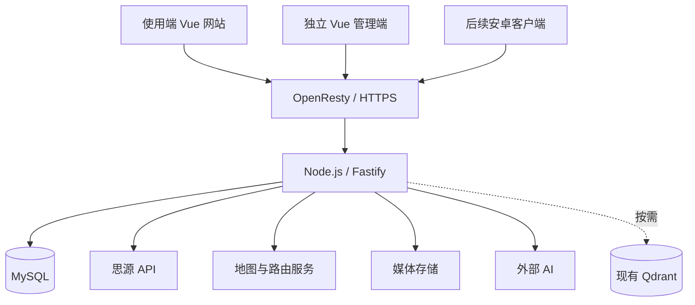

# 技术方案与初步选型

更新：2026-10-22（通用官方资料核查为 2026-10-21，M2 新依赖为 2026-10-22）。本文记录技术选择；M1–M2 已采用 Fastify／TypeBox、Drizzle／mysql2、Sharp 与独立 Vue 管理端，安装和验收见 [开发记录](development.md)。其他模块按表内状态区分。状态以 [决策记录](decisions.md) 为准；精确版本锁定于 lockfile。

## 1. 范围与可行性结论

项目整体可行。普通地图展示、地点搜索、日记、资料同步与分享有成熟实现方向；需要实测的是国内目标山路的路网覆盖、定位匹配，以及规划数据的长期保存和导出授权。

已确认：Vue 3 + Vite + TypeScript、Node.js + TypeScript、本机 MySQL、网站优先、预留 Capacitor、独立管理界面。M1 后端与数据库库已在授权开发中采用，其余库及供应商仍按阶段验证。

## 2. 技术方向清单

| 方向 | 候选与当前建议 | 状态／安排 |
| --- | --- | --- |
| 使用端 | Vue 3 + Vite + TypeScript | 已确认，以 v4 为设计依据 |
| 路由与状态 | Vue Router + Vue 响应式状态；Pinia 按需 | M1 已采用，无独立状态库 |
| 使用端 UI | 复用 OpenDesign CSS／图标／结构，迁移 Vue 组件 | M1–M2 已采用，日记页懒加载 |
| 管理端 | 独立 Vue 构建、共用基础样式／组件 | M2 已实现，未引入 Element Plus |
| 安卓 | Capacitor 复用网页资源，插件处理系统能力 | 预留，后置真机验证 |
| 足迹总览 | 矢量行政区图、自己的统计与标记 | 保留原型方向，核对边界数据来源 |
| 详细地图 | 高德 JS API；腾讯主要备选 | M3.1 接入底图／选点和官方显示转换；真实 SDK／域名上下文已通，外部网络与完整使用范围待验 |
| 户外专题地图 | OSM 数据；OpenHikingMap／OpenTopoMap 等图源；Leaflet 或 MapLibre 按图源选择 | M3.2 已采用 Leaflet 1.9.4／OpenHikingMap，按需加载 WGS84 独立模式；见 M3.2 专题 |
| 搜索选点 | 地图 POI + 本地目的地及别名 | 待样本验证，匹配结果需确认 |
| 路线生成 | 自动规划 + 导入参考 + 手工补绘 | M3 已组合实现；自动规划目前为本机区域 BRouter 徒步候选，非全国／多交通方式 |
| 路线编辑 | 分日地点、分段交通、计划／实际及版本 | 首版核心 |
| 文件互通 | GPX／GeoJSON 导入导出 | M3.1 已实现受控 GPX、多段、采样与原件；GeoJSON 后续 |
| 海拔地形 | 文件海拔或外部高程数据 | 后置，标注估算及来源 |
| API 框架 | Fastify | M1–M2 已采用 |
| 校验与契约 | TypeBox／JSON Schema；OpenAPI 后续 | 已采用运行时校验，尚未生成 OpenAPI |
| 数据访问 | Drizzle + mysql2 | 迁移、事务与版本并发已验证 |
| 数据库 | 本机 MySQL 8.4，独立库与账号 | M3.2 迁移后 17 张业务表和账本；驱动与持久化已验 |
| 登录 | 密码认证 + 服务端会话 | M1 已采用，M2 加入用户管理与撤销 |
| 权限 | 角色、owner_id、内容可见性、管理 API 校验 | 首版建立 |
| 图文 | 纯文本段落、有序照片及说明 | M2 已采用，富文本后置 |
| 图片处理 | Sharp 缩放、旋转、压缩；衍生图去除 EXIF 等元数据 | 静态格式和合成 EXIF 样本已验；真手机样本待补 |
| 媒体存储 | 本机私有目录，保留存储类边界 | M2 已采用；对象存储供应商和整体恢复待验 |
| 思源接入 | 官方 API 单向增量读取，提取后审核 | 建议初选，先验证少量资料 |
| 基础搜索 | 结构化筛选、别名、关键词、MySQL ngram 全文检索 | 先行验证 |
| 语义搜索 | 复用已有 Qdrant，独立 collection | 根据搜索效果引入 |
| AI | 外部模型 API、资料检索、结构化草稿、SSE | 供应商及模型待对比 |
| 动态出行信息 | 天气／地图等已授权接口、官方信息链接与核验日期 | 逐项接入，不预设实时交通数据一定可得 |
| 任务执行 | MySQL 任务表、定时扫描、限并发与重试 | M3.2 已实现持久化算路任务、单进程限并发与租约；复杂后再评估 Redis 队列 |
| 分享 | 服务端权限、可撤销链接、访客阅读页 | 核心实现；海报等后置 |
| 导出与备份 | 业务 JSON／图文／媒体备份、MySQL 备份及恢复 | 与正式存储一起建设 |
| 部署 | OpenResty + 独立前端 + 单 API 服务 | 当前 preview 用 screen（用户要求），不使用 systemd；正式静态托管按 M4 |
| 验证与运维 | 接口、关键浏览器流程、健康检查、结构化日志 | 开发时建立 |

官方能力参考：[Vue 状态管理](https://vuejs.org/guide/scaling-up/state-management.html)、[Vue Router](https://router.vuejs.org/)、[Element Plus](https://element-plus.org/en-US/)、[Fastify 类型与校验](https://fastify.dev/docs/latest/Reference/Type-Providers/)、[Fastify OpenAPI 插件](https://github.com/fastify/fastify-swagger)、[Drizzle MySQL](https://orm.drizzle.team/docs/mysql/get-started-mysql)。

## 3. Node.js 与 Go 的取舍记录

本项目主要是数据库查询、思源读取、地图和 AI 网络请求，适合 Node.js 异步 I/O。统一 TS 有助于前后端共享接口类型和部分校验规则。

Go 同样能实现所有业务，编译部署和多核并行是可行优势；使用 OpenAPI 也能维持前后端一致。性能和内存差距不能脱离实际实现预设。用户已经选择 Node.js + TS，当前不并行开发 Go 版本。

大量轨迹解析、图片批处理或 CPU 密集的 JS 运算需要控制规模，必要时使用工作线程／独立进程。`async` 不会自动把计算移出主线程。

参考：[Node 事件循环](https://nodejs.org/learn/asynchronous-work/dont-block-the-event-loop)、[工作线程](https://nodejs.org/api/worker_threads.html)、[Go FAQ](https://go.dev/doc/faq)、[TypeScript 基础](https://www.typescriptlang.org/docs/handbook/2/basic-types.html)。

## 4. 客户端与代码组织

使用端保留 v4 的视觉与交互，逐步转换为 Vue 组件；原型代码不是已经接入正式 API 的应用。管理端独立页面、独立构建，避免组件和资源被打入使用端首屏。

仓库共享接口契约、业务类型和基础校验，使用端 `frontend/`、管理端 `admin/`、后端 `backend/` 分别组织，共享契约在 `packages/contracts/`。管理端不混入使用端资源与导航。

网站先采用静态资源 + API。Capacitor 后续验证登录会话、来源限制、地图加载、照片选择、返回键、安全区与键盘。网页打包不等于完全无需适配，也不等于所有平台可共用同一种地图 Key。

参考：[Capacitor 安装与打包](https://capacitorjs.com/docs/getting-started)、[配置](https://capacitorjs.com/docs/config)。

## 5. 后端、数据与权限

采用模块化单体：账号权限、行程、路线、资料、日记媒体、分享、AI、管理功能分模块；首版以一个业务 API 服务运行。

| 数据层 | 要求 |
| --- | --- |
| 身份与访问 | 用户、角色、可撤销会话、数据归属；管理入口和管理 API 都校验权限 |
| 研究资料 | 原始思源快照、来源与引用、提取结果、审核状态、版本 |
| 地理与模板 | 目的地、别名、候选匹配、路线模板、节点、坐标系与来源 |
| 行程与记录 | 行程、多目的地、每日安排、计划／实际路段、主动确认到访 |
| 内容与分享 | 日记内容块、媒体对象、关联、可见性、分享令牌与撤销状态 |
| 运行支撑 | 同步任务、失败原因、审计事件、数据库迁移版本 |

MySQL 普通关系表 + 明确坐标系的几何 JSON 可起步；空间索引由实际范围／邻近查询决定，不预先引入第二套空间数据库。外键、事务与变更版本保证跨对象一致性。

路线部分已细化为 [数据模型 v0.1](route-domain-model.md) 与 [API／适配契约 v0.1](route-api-contract.md)：计划和实际独立对象，编辑使用版本化命令，自动计算只产生候选，输入指纹防止迟到结果覆盖新安排。两文档描述完整目标；M1 编辑、M2 actual 与 M3.1 不可变手工／导入几何、GPX 和核对保护已实现，异步算路候选后续加入。

M1 网站会话已使用 HttpOnly／SameSite Cookie、数据库会话撤销、CSRF 和请求来源检查；Secure 在 HTTPS 部署启用，本机 HTTP 预览关闭。未来安卓认证方式另行适配。不可仅依赖前端隐藏按钮保证权限。

本机 `.env` 保留服务密钥。浏览器可见地图 Key 按供应商要求限制来源与额度，WebService 密钥只由后端使用；后端业务接口不做面向外部的通用地图 API 转售或无限转发。

## 6. 日记、图片与存储

简单段落、照片、说明先按内容块保存；需要复杂图文穿插时评估 Tiptap。编辑器负责内容，不自动提供上传、私密存储或分享权限。

上传链路：验证格式与大小 → 提取所需原始元数据 → 受控生成阅读图与缩略图 → 保存媒体记录 → 关联日记。原图、阅读图与缩略图分开管理，公开衍生图移除不应公开的位置等元数据。原图保留策略和容量上限待确认。

初选 Sharp；EXIF 可评估 ExifTool 等工具。手机原图、相册转存图可能缺失坐标或时间，不能默认为可自动重建路线；HEIC 等格式须用实际手机照片验证后决定支持范围。

统一存储接口，允许本地目录与对象存储适配。长期优先对象存储，选择要比较国内访问、费用、签名访问、备份及可迁移性。私密照片、缩略图及封面受同一访问规则约束；不能因复用封面泄露私密日记。

v4 IndexedDB 后续可保留为草稿层；正式保存内容以服务器为准，携带版本处理多设备冲突。若导入原型本机记录，使用用户主动导出／导入的版本化格式，不能直接假设所有浏览器共享数据。

参考：[Tiptap](https://tiptap.dev/docs/editor/getting-started/overview)、[图片扩展](https://tiptap.dev/docs/editor/extensions/nodes/image)、[Sharp](https://sharp.pixelplumbing.com/)、[ExifTool GPS](https://exiftool.org/TagNames/GPS.html)。

## 7. 思源、搜索与 AI

思源接入细节见 [数据源调查](data-sources.md)。建议单向读取指定根文档及后代，快照、提取、人工修订与个人行程分开；新增或变化产生待审版本。删除／移动资料先标记待处理，不级联删除旅行记忆。

基础搜索按地区、月份、天数、玩法等结构化字段、别名和关键词展开；验证 MySQL ngram 中文全文检索。缺少字段与已知不匹配分别处理。

AI 流程：提取出行条件 → 权限范围内筛选／检索 → 必要时查询动态信息 → 带引用回答或结构化草稿 → 用户确认加入。不能由模型凭空产生精确路线几何、当天开放状态和实际到访。

先比较通义千问、DeepSeek 等外部服务在实际旅行问题上的质量、引用、字段提取、流式输出、延迟与费用；模型名称和 API 功能在实施时复核。不预设所有兼容接口都支持相同的 JSON Schema 或工具调用语义。

初期可直接使用模型 HTTP API 与有限的服务函数；根据实际复杂度再评估 AI 编排框架。语义检索需要时复用 Qdrant；owner_id、可见性和来源条件必须在检索阶段过滤，不能生成回答后再剔除私密内容。

参考：[MySQL ngram](https://dev.mysql.com/doc/refman/8.4/en/fulltext-search-ngram.html)、[Qdrant 过滤](https://qdrant.tech/documentation/search/filtering/)、[百炼流式输出](https://docs.bailian.console.aliyun.com/zh/model-studio/stream)、[DeepSeek 接口](https://api-docs.deepseek.com/api/create-chat-completion/)。

## 8. 部署、任务与运行维护

两套前端可通过独立路径或域名访问。当前建议 OpenResty 提供静态资源和 API 反向代理，Docker Compose 管理 API；systemd 是可选方式。初期不增加第二套 MySQL、全国路网服务或本地大模型。

任务初选 MySQL 记录、定时扫描、有限并发、重试与幂等标识。只有实际任务量和可靠性需求超过该方案时再评估 Redis 队列；已有 Redis 不等于必须增加依赖。

日志记录请求 ID、任务状态、错误和供应商耗时；密钥、完整私密正文、带凭据 URL 不写日志。接口包含健康检查及依赖故障反馈。用数据库备份、媒体备份与恢复演练验证可恢复性，不能只检查备份文件存在。

资源快照见 [数据源调查](data-sources.md)。性能需要用实际部署测量；交换空间已使用，不能把总内存或 Swap 当作空闲服务预算。

## 9. 费用及授权决定项

- 地图初始化、POI 搜索、路线、坐标转换等可能分别计量，以账号当前权限为准。
- 逐段规划中，10 个节点通常对应 9 对相邻起终点；多次改动会重复调用。仅重新计算受影响路段，缓存／保存范围先核对协议。
- AI 关注提取、问答、向量化、长文上下文与重复同步的调用量。
- 媒体关注原图、衍生图、备份、出站流量和请求，不只比较存储单价。
- 地图几何、资料参考图片、原型示例摄影各自保留来源与使用范围；开放接口或可下载不代表无限再发布。

## 10. 下一步顺序

先验证地图账号与授权、典型 POI、五类路段、坐标与文件；并行在不依赖地图的样本上确定思源提取及媒体流程。依据证据收敛供应商，再确定数据库和接口，随后实现使用端和独立管理端。详细步骤见 [验证计划](validation-plan.md)。
